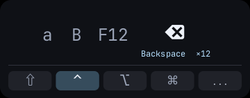

# hyprkey

A lightweight, zero-dependency keystroke HUD for **Wayland & Hyprland**, built with Rust and native `wlr-layer-shell`.



## Features

- **Native Wayland Overlay**: Uses `zwlr_layer_shell_v1` on `Layer::Overlay`. Stays on top without requiring special Hyprland window rules.
- **Click-Through**: Clicks outside the HUD area pass directly to underlying windows.
- **Minimal Resource Usage**: CPU software rasterization with shared-memory buffers (`wl_shm`). No Electron, Tauri, WebKit, OpenGL, or GUI framework overhead.
- **Embedded Font**: Self-contained with bundled JetBrains Mono; no system font installation required.
- **Draggable**: Drag the top key area to reposition anywhere on the screen.
- **Repeat Counter**: Consecutive key presses and held auto-repeats show as counters (e.g. `×3`).
- **Modifier Display**: Highlights `⇧` Shift, `⌃` Ctrl, `⌥` Alt, and `⌘` Super while held.
- **Smart Caps Lock**: Syncs directly with Hyprland to respect custom XKB remaps (such as `caps:escape_shifted_capslock`).
- **Customizable**: Built-in settings menu (`...`) for HUD scaling (50–200%), font size, history length, auto-hide, and timeout.

## Requirements

- **OS**: Linux
- **Compositor**: Hyprland or any Wayland compositor supporting `zwlr_layer_shell_v1` and `zwp_relative_pointer_v1`.
- **Permissions**: Read access to `/dev/input/event*` (typically via the `input` group):
  ```sh
  sudo usermod -aG input "$USER"
  ```
  *(Log out and back in for membership to take effect)*

## Installation

### From Release Archive

Download and extract the latest tarball from [Releases](https://github.com/):

```sh
tar -xzf hyprkey-*.tar.gz
cd hyprkey-*
./hyprkey
```

### Build from Source

Ensure you have Rust, a C compiler, `pkg-config`, and Wayland development libraries (`wayland` on Arch Linux, `libwayland-dev` on Ubuntu/Debian):

```sh
cargo build --release --locked
./target/release/hyprkey
```

## Configuration

Settings are saved automatically to `~/.config/hyprkey/settings.json`. Click the **`...`** button on the HUD to adjust settings in real-time.

## Development

```sh
cargo fmt --check
cargo test --locked
cargo clippy --locked --all-targets -- -D warnings
scripts/package-release.sh
```

## License

- Code: [MIT](LICENSE)
- Bundled Font: [SIL Open Font License 1.1](assets/fonts/OFL.txt)
